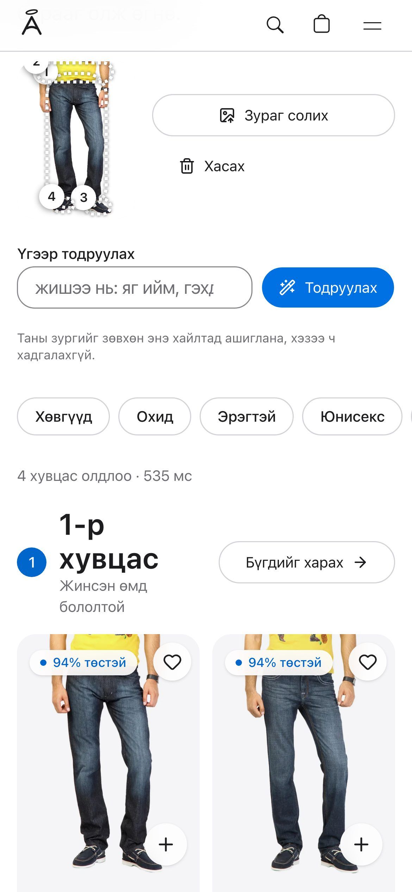
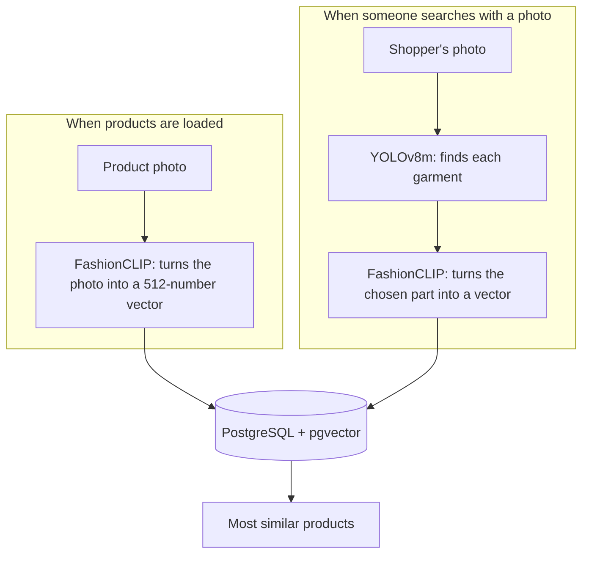
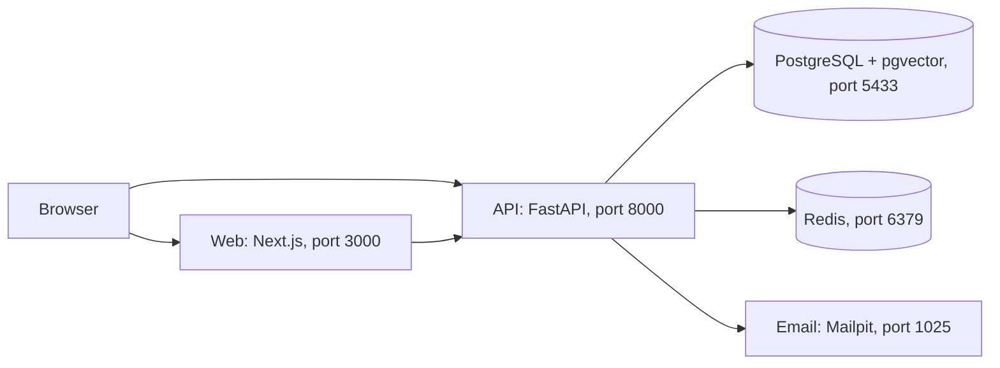

# Angel — Image-Based Similar Clothing Product Recommendation System

[](https://github.com/Iluminimal/Image-Based-Similar-Clothing-Product-Recommendation-System/actions/workflows/ci.yml)
[](LICENSE)

[Монгол](README.md) · **English**

**Search for clothes with a photo.** Upload a photo of a garment, or take one with the camera, and Angel finds similar
products. It is a diploma project: an online shop with visual search, plus admin and warehouse back offices.


| Category menu | Bag | Search on a phone |
| --- | --- | --- |
|  |  |  |

The screenshots show the Mongolian interface, which is the default.

## Contents

- [Features](#features)
- [How it works](#how-it-works)
- [Tech stack](#tech-stack)
- [What you need](#what-you-need)
- [Quick start (without the dataset)](#quick-start-without-the-dataset)
- [Running with the real dataset](#running-with-the-real-dataset)
- [Using the app](#using-the-app)
- [Stopping, restarting, updating](#stopping-restarting-updating)
- [Configuration](#configuration)
- [Tests and quality checks](#tests-and-quality-checks)
- [Deploying to a server](#deploying-to-a-server)
- [Common problems and fixes](#common-problems-and-fixes)
- [Project layout and documentation](#project-layout-and-documentation)
- [License](#license)

## Features

**Shoppers**

- Search with a photo, with words (Mongolian or English), or with a photo plus words. Each garment, shoe and bag in a
  photo is found separately. In camera mode the garments are outlined live.
- Categories, filters, reviews, similar products and a wishlist.
- Bag, orders, QPay payment, cancellation and return requests.
- Sign in with a one-time code sent by email or SMS, with a password, or with Google.

**Warehouse workers**

- Add and edit products. Change price and stock count straight from the list.
- Start or stop selling a product with a switch. Delete a product that has never been ordered.
- Ship orders. Count and record the stock in the warehouse.

**Administrators**

- Dashboard, orders, customers, reviews, activity log and CSV reports.
- Refund orders and decide cancellation and return requests. Products are view-only.

The site opens in Mongolian. Switch to English at the bottom of any shop page. Prices are in Mongolian tögrög (₮).

## How it works



1. The [FashionCLIP](https://huggingface.co/patrickjohncyh/fashion-clip) model turns every product photo into a vector
   of 512 numbers. The vectors are stored in PostgreSQL with [pgvector](https://github.com/pgvector/pgvector) (HNSW
   index, cosine distance).
2. On a search photo, the [YOLOv8m](https://huggingface.co/NovaAstro/YOLOv8m_fashion) model finds each garment.
3. The chosen part becomes a vector the same way, and the database returns the products with the closest vectors.

Search photos and camera frames are not stored. A comparison of FashionCLIP with Marqo-FashionSigLIP and ResNet-50 is
in [`docs/ml-comparison.md`](docs/ml-comparison.md).

The running system:



## Tech stack

| Part | Technology |
| --- | --- |
| Web | Next.js 16, React 19, TypeScript, Tailwind CSS v4, shadcn/ui, TanStack Query, next-intl |
| API | Python 3.12, FastAPI, Pydantic v2, SQLAlchemy 2 (async), Alembic |
| Data | PostgreSQL 18 + pgvector, Redis 8 |
| ML | PyTorch, FashionCLIP, YOLOv8 (Ultralytics) |
| Tools | uv, Ruff, mypy, ESLint, Vitest, pytest, Playwright, Docker, GitHub Actions |

## What you need

### Computer

| Item | Notes |
| --- | --- |
| Operating system | Developed and tested on **macOS (Apple Silicon)**. Not tested on Windows (you can try WSL2). Running it by hand on Linux is not tested: GitHub Actions runs the tests on Ubuntu. On Linux the CPU build of PyTorch is installed. |
| Memory | It was developed on an M1 with 8 GB. |
| Disk space | Project libraries and Docker images: about 4 GB. The real models: 0.8 GB more. The real dataset: see [that section](#running-with-the-real-dataset). |
| Internet | Needed for the first install and for downloading the models. |

### Tools

| Tool | Install on macOS | Check |
| --- | --- | --- |
| git, make | `xcode-select --install` | `git --version`, `make --version` |
| [Node.js](https://nodejs.org) 24 or newer (CI uses 24; tested on 26) | `brew install node@24` (see the note below) | `node -v` |
| [uv](https://docs.astral.sh/uv/getting-started/installation/) | `brew install uv` | `uv --version` |
| [Docker Desktop](https://docs.docker.com/get-started/get-docker/) | `brew install --cask docker-desktop` | `docker compose version` |

- If the `brew` command does not work, install [Homebrew](https://brew.sh) first.
- Homebrew does not add `node@24` to your `PATH`. Run this line, then open a new terminal:

  ```bash
  echo "export PATH=\"$(brew --prefix node@24)/bin:\$PATH\"" >> ~/.zshrc
  ```

- **You do not need to install Python.** `uv` downloads the right version (3.12) itself.
- After installing Docker Desktop, **open it once** and wait until it has fully started.

## Quick start (without the dataset)

This is the fastest way: no dataset and no ML model download. It creates 60 made-up products. The shop, orders, admin
and warehouse areas all work.

> [!NOTE]
> In this mode **photo search returns meaningless results**: the search runs, but it does not measure similarity. To see
> real search, [load the real dataset](#running-with-the-real-dataset).

### 1. Get the code

```bash
git clone https://github.com/Iluminimal/Image-Based-Similar-Clothing-Product-Recommendation-System.git
cd Image-Based-Similar-Clothing-Product-Recommendation-System
```

**Run every command below from this top folder.**

### 2. Install the libraries

```bash
make install
```

This installs the API (Python) and web (Node.js) libraries. The first time can take a few minutes. Lines that start with
`npm warn` are not errors. It worked if the command finishes without an error.

### 3. Start the database, Redis and Mailpit

Docker Desktop must be running.

```bash
make infra
```

This creates the settings file `.env` from `.env.example` and starts three containers. It worked if all three show
`Healthy`.

> [!IMPORTANT]
> The Docker project is always named `angel`. If you have **two copies** of this project on one computer, both use
> **the same database**: `make seed-e2e` or `make infra-reset` in one copy affects the other's data. To keep them apart,
> in the second copy run `cp .env.example .env` first, add the line `COMPOSE_PROJECT_NAME=angel2` to `.env` and
> [change the ports](#common-problems-and-fixes). Then run `make infra`.

### 4. Choose the no-dataset mode

Open `.env` in an editor (macOS: `open -e .env`). Find these **two lines** and change their values:

```bash
EMBEDDER=fake
LOCALIZER=whole
```

### 5. Create the tables and trial products

```bash
make migrate    # database tables
make seed-e2e   # 60 made-up products
```

Do not run `make seed-e2e` on a database with real products: it adds 60 made-up ones.

### 6. Run it

Open **two separate terminals** and go to the top folder in both:

```bash
make api   # terminal 1: API
```

```bash
make web   # terminal 2: web
```

Both commands have to keep running, so leave the terminals open.

### 7. Check

| Open | It worked if |
| --- | --- |
| <http://localhost:8000/readyz> | You see `"status":"ok"`, and `database`, `redis` and `model` are all `ok` |
| <http://localhost:3000> | The shop's home page with the trial products |

The first visit to a page takes a few seconds while it is prepared.

## Running with the real dataset

First do **steps 1–3** of the [quick start](#quick-start-without-the-dataset).

### 1. Download the dataset

Sign in to Kaggle and download the
[Fashion Product Images Dataset](https://www.kaggle.com/datasets/paramaggarwal/fashion-product-images-dataset).
**Read its license and terms of use before you download it.**

- The full version is large: the Kaggle page gives a total size of about **25 GB** (another part of the page shows
  15.7 GB). Make sure you have room to download and unpack it.
- The [small version](https://www.kaggle.com/datasets/paramaggarwal/fashion-product-images-small) (about 600 MB) has
  low-resolution photos. It has not been tested with this project.

After unpacking, find the folder that holds **both** the `styles.csv` file and the `images/` folder:

```
my-dataset/          ← DATASET_DIR points here
├── styles.csv
└── images/
    ├── 1163.jpg
    └── ...
```

### 2. Configure

In `.env`:

```bash
DATASET_DIR=/Users/your-name/Datasets/my-dataset
EMBEDDER=fashion-clip
LOCALIZER=yolo
```

Put the full path of your folder in `DATASET_DIR`. `EMBEDDER` and `LOCALIZER` have these values by default.

> [!WARNING]
> If you ran the no-dataset mode before, first stop the web and the API (`Ctrl+C`), then remove the old trial data.
> `make infra-reset` **deletes the whole database** (accounts and orders too).
>
> ```bash
> make infra-reset
> rm -rf apps/web/.next    # old responses saved by the web app
> make infra
> ```

### 3. Load the products

```bash
make migrate
make ingest ARGS="--limit 500"   # try 500 products first
make ingest                      # all products
```

- The first run downloads the FashionCLIP model (about 0.6 GB) from Hugging Face. The API downloads the YOLO model that
  finds garments (about 0.2 GB) the first time it starts.
- On an M1 with 8 GB, loading all 41,885 products took **16–25 minutes**.
- The small product images go to `data/media/` (about 1.3 GB), and the database takes about 0.25 GB.
- You can stop it with `Ctrl+C`. Running it again continues where it left off.
- The dataset has no prices or stock, so they are generated by a fixed, repeatable rule.

Then run `make api` and `make web`. Details are in [`docs/ml-pipeline.md`](docs/ml-pipeline.md).

## Using the app

### Addresses

| What | Address |
| --- | --- |
| Shop | <http://localhost:3000> |
| Sign in (shoppers and staff) | <http://localhost:3000/login> |
| Admin and warehouse area | <http://localhost:3000/admin> |
| API documentation (Swagger) | <http://localhost:8000/api/v1/docs> |
| Sent emails (Mailpit) | <http://localhost:8025> |
| Is the API ready? | <http://localhost:8000/readyz> |

The button names below are the English ones. Switch the language at the bottom of a shop page first.

### Create a shopper account

1. On <http://localhost:3000/login>, type an email address or a phone number and press **Continue**.
2. For a **phone number**, a 6-digit code is sent right away. For an **email**, a password screen appears: a new shopper
   presses **Email me a code instead**.
3. Enter the code, then your name.

In development no real email or SMS is sent. Find the code here:

- **Email code:** <http://localhost:8025> (Mailpit).
- **SMS code:** look for the `sms_sent` line in the terminal running `make api`. The code is the first 6 digits of
  `"body"`.

A number typed without a country code is read as a Mongolian one (`DEFAULT_PHONE_REGION`).

### Create an administrator and a warehouse worker

Staff cannot register on the website. Create them from the terminal (after `make infra` and `make migrate`):

```bash
make create-admin EMAIL=admin@example.com
make create-warehouse EMAIL=warehouse@example.com
```

It asks for a password (10–128 characters) twice, without showing what you type. Then sign in on
<http://localhost:3000/login> with the email and password. Running the same command again sets a new password.

### Try photo search

Press **Search by photo** on the home page or inside the search box (or open <http://localhost:3000/search>). You can
choose, drag and drop or paste a photo, or use the camera. JPEG, PNG and WebP photos work.

### Orders and the test payment

1. Pick a product (choose a size if it has sizes) and add it to the bag.
2. Sign in and enter a delivery address.
3. In development `PAYMENTS_MODE=offline`, so you get a **test payment**. No real money is charged.

To connect real QPay, see [`docs/commerce.md`](docs/commerce.md).

### Sample data for the admin dashboard

After loading products:

```bash
make seed-demo        # made-up customers, orders and reviews
make seed-demo-clean  # remove them
```

The made-up customers have `demo-...@example.com` addresses and the password `DemoPass12345`. For development only.

## Stopping, restarting, updating

**Stop:** press `Ctrl+C` in each terminal running `make api` or `make web`, then:

```bash
make infra-down   # stops the containers; data is kept
```

**Start again:** open Docker Desktop, run `make infra`, then `make api` and `make web` in two terminals.

**Get new code:** stop the web and the API, then:

```bash
git pull
make install
make infra
make migrate
```

Then run `make api` and `make web` again.

**Start from scratch:** `make infra-reset` **permanently deletes** the database. Then run `rm -rf apps/web/.next`,
`make infra` and `make migrate`, and load the products again.

## Configuration

All settings are in the `.env` file in the top folder. `make infra` creates it from [`.env.example`](.env.example) the
first time. That file explains every value (in Mongolian). Restart the API after a change. **Never commit `.env`.**

| Variable | What it is for | Development default |
| --- | --- | --- |
| `EMBEDDER`, `LOCALIZER` | ML models. `fake` and `whole` in no-dataset mode | `fashion-clip`, `yolo` |
| `DATASET_DIR` | Dataset folder (only for `make ingest`) | a sample path |
| `DATABASE_URL`, `REDIS_URL` | Addresses of the database and Redis | `localhost:5433`, `localhost:6379` |
| `JWT_SECRET` | Secret key for sign-in. If empty, everyone is signed out whenever the API restarts | empty |
| `PAYMENTS_MODE` | `offline` test payment, `qpay` real payment | `offline` |
| `MAIL_MODE`, `SMTP_*` | Sending email | Mailpit (`smtp`, port 1025) |
| `SMS_MODE`, `TWILIO_*` | Sending SMS: `console` (write to the log) or `twilio` | `console` |
| `GOOGLE_CLIENT_ID`, `GOOGLE_CLIENT_SECRET` | Sign in with Google. The button is hidden if empty | empty |
| `RATE_LIMIT_ENABLED` | Limits too many requests | `true` |

To make a secret key: `openssl rand -base64 48`.

The web app's addresses are set separately. The defaults are `http://localhost:8000` (API) and `http://localhost:3000`
(web). To change them, copy [`apps/web/.env.example`](apps/web/.env.example) to `apps/web/.env.local`.

## Tests and quality checks

```bash
make infra migrate
make test        # API (pytest) and web (Vitest) tests
make lint        # Ruff, ESLint
make typecheck   # mypy, TypeScript
```

| Other commands | What they do |
| --- | --- |
| `make test-ml` | Tests with the real FashionCLIP and YOLO models (downloads about 0.8 GB the first time) |
| `make api-types` | Refreshes the web app's TypeScript types after an API change |
| `make e2e` | Browser (Playwright) tests |
| `make help` | Lists every command |

Read [`docs/e2e.md`](docs/e2e.md) before running the browser tests. The first time you also need
`cd apps/web && npx playwright install chromium`.

> [!WARNING]
> Running `make e2e` against a database with your own data **changes the passwords** of `admin@example.com` and
> `warehouse@example.com` and adds test data. `docs/e2e.md` explains how to run it on a separate database.

GitHub Actions ([`.github/workflows/ci.yml`](.github/workflows/ci.yml)) runs lint, type checks, tests, browser tests and
the Docker image builds on every push to `main` and on every pull request.

## Deploying to a server

One server running Docker Compose: Caddy (HTTPS) → web → API → PostgreSQL, Redis.

**Read first:** [`docs/production-checklist.md`](docs/production-checklist.md) (what to fix and prepare before going
live) and [`docs/deploy.md`](docs/deploy.md) (step-by-step guide).

- You need a server with 4 GB of memory or more and about 15 GB of disk, and a domain name.
- You need QPay, Twilio (SMS), SMTP (email) and Google OAuth accounts. The production API refuses to start with the
  development stand-ins.

```bash
cp .env.prod.example .env.prod   # fill in every CHANGE_ME value
make deploy-check                # reports missing or forbidden values
docker compose -f infra/docker-compose.prod.yml --env-file .env.prod up -d --build
```

## Common problems and fixes

| Problem | Fix |
| --- | --- |
| `make: command not found`, `git: command not found` | On macOS: `xcode-select --install` |
| `make infra` cannot connect to Docker | Open Docker Desktop and wait until it has fully started |
| `port is already allocated` (5433, 6379, 1025, 8025) | Change the port in `.env`. With `POSTGRES_PORT` also change `DATABASE_URL`, with `REDIS_PORT` change `REDIS_URL`, and with `MAILPIT_SMTP_PORT` change `SMTP_PORT`. `MAILPIT_UI_PORT` is the port of the email viewer |
| Port 3000 or 8000 is busy | Find the program using it with `lsof -nP -iTCP:3000 -sTCP:LISTEN` (or `8000`) and stop it. If the web app starts on another port, the settings no longer match |
| `/readyz` returns 503 | The answer shows which of `database`, `redis`, `model` is `fail`. Usually `make infra` is not running |
| `relation ... does not exist` in the API log | Run `make migrate` |
| The shop has no products | Check that you ran `make seed-e2e` or `make ingest`. Then wait a few minutes, or stop the web app, run `rm -rf apps/web/.next` and start it again |
| Old products or prices after recreating the database | The web app keeps API responses on disk for a while. Stop it, run `rm -rf apps/web/.next` and start it again |
| Pages return error 500 after getting new code | Stop `make web`, run `make install` and start it again. If that does not help, run `rm -rf apps/web/.next` |
| The API is slow to start the first time | With the real models, the first start downloads them. Without the dataset, check that `.env` has `EMBEDDER=fake` and `LOCALIZER=whole` |
| The one-time code does not arrive | Find email codes at <http://localhost:8025> and SMS codes in the API terminal. Wait 60 seconds before asking again. At most 5 codes are sent per hour |
| "Too many requests" (429) | Wait a moment. Only when testing on your own computer: set `RATE_LIMIT_ENABLED=false` in `.env` |
| Forgot a staff password | Run `make create-admin EMAIL=...` or `make create-warehouse EMAIL=...` again to set a new one |
| Lost the phone used for two-factor sign-in | `make reset-2fa EMAIL=...` |
| Signed out every time the API restarts | Set `JWT_SECRET` in `.env` to a random value of 32 characters or more |
| The camera does not start | Browsers allow the camera only on `localhost` or an HTTPS address. Check the browser's camera permission |

## Project layout and documentation

```
apps/
  api/             Backend (FastAPI): routes → services → repositories → models
    src/angel/         code
    migrations/        database changes (Alembic)
    tests/             tests
  web/             Frontend (Next.js)
    src/               code
    messages/          Mongolian and English texts
    e2e/               browser tests
scripts/           dataset loading, sample data and measurement scripts
infra/             Docker Compose, Caddy
docs/              documentation, screenshots, measurement results
```

- **Reading the code:** each main folder has a `README.md` that says what lives there and where to add new things. These
  guides and the code comments are written **in Mongolian**. Start with
  [`apps/api/src/angel/README.md`](apps/api/src/angel/README.md) and
  [`apps/web/src/README.md`](apps/web/src/README.md).
- **Mongolian terms used in the interface:** [`docs/glossary-mn.md`](docs/glossary-mn.md).
- **Documentation** (mostly in English): [Architecture](docs/architecture.md) ·
  [Development guide](docs/development.md) · [Specification](docs/SPEC.md) · [Accounts](docs/accounts.md) ·
  [Commerce](docs/commerce.md) · [Admin](docs/admin.md) · [Search API](docs/search-api.md) ·
  [ML pipeline](docs/ml-pipeline.md) · [Frontend](docs/frontend.md) · [Deploy](docs/deploy.md) ·
  [End-to-end tests](docs/e2e.md)

## License

The code in this repository is under the [MIT](LICENSE) license. These third-party items have their own terms:

- The **dataset** is not in the repository. The screenshots on this page show product photos from the
  [Fashion Product Images dataset by paramaggarwal](https://www.kaggle.com/datasets/paramaggarwal/fashion-product-images-dataset)
  on Kaggle. Check its license and terms of use before downloading it. Get separate permission to reuse the product
  photos, especially for commercial use.
- The **FashionCLIP** model page states the MIT license.
- The **YOLOv8m_fashion** weights are labelled Apache-2.0. They are in pickle format, so the code downloads them only
  from a fixed commit.
- The **Ultralytics** library is licensed under AGPL-3.0 (or the company's commercial license). Check the terms before
  you run a service without publishing your source code.
