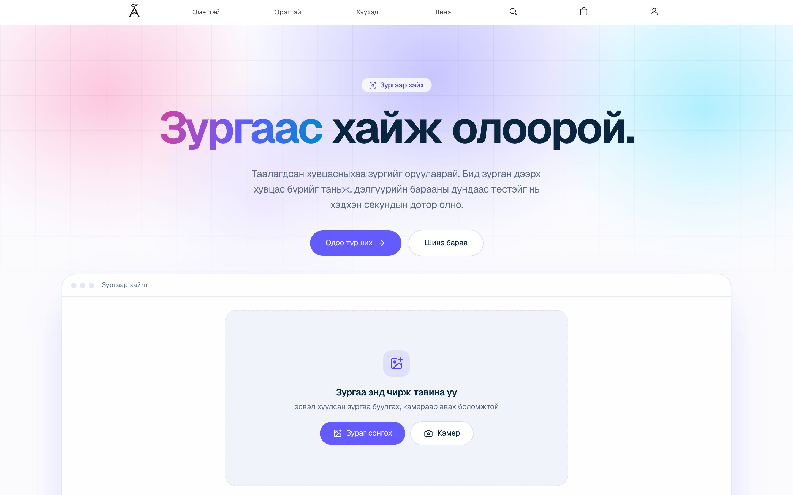
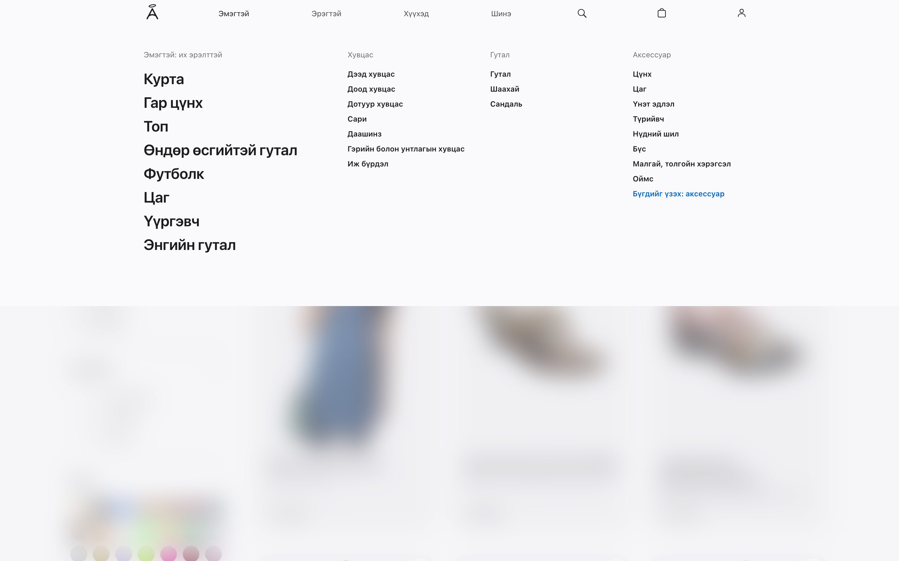
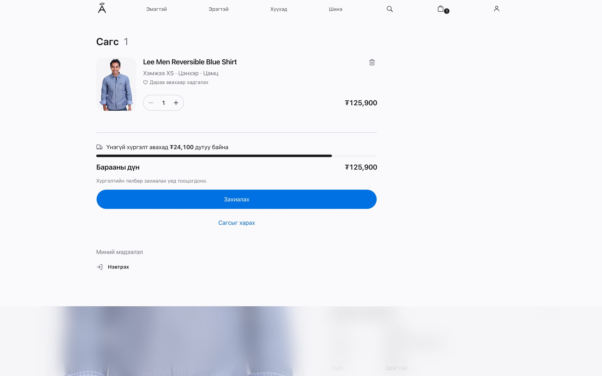

# Angel — Image-Based Similar Clothing Product Recommendation System

[](https://github.com/Iluminimal/Image-Based-Similar-Clothing-Product-Recommendation-System/actions/workflows/ci.yml)
[](LICENSE)

[Монгол](README.md) · **English**

An online shop that finds similar products when you upload a photo of clothing. A diploma project.



| Category menu | Bag | Search on a phone |
| --- | --- | --- |
|  |  |  |

- **Shoppers:** search with a photo or words, bag, orders, QPay payment.
- **Warehouse workers:** add, edit and delete products, ship orders.
- **Administrators:** orders, refunds, customers, reviews, reports.

**Tech:** Next.js, FastAPI, PostgreSQL + pgvector, Redis, FashionCLIP, YOLOv8.

## Requirements

Tested on macOS (Apple Silicon).

| Tool | Install command |
| --- | --- |
| git, make | `xcode-select --install` |
| Node.js 24 or newer | `brew install node@24` |
| uv (downloads Python itself) | `brew install uv` |
| Docker Desktop | `brew install --cask docker-desktop` |

If you do not have `brew`, install [Homebrew](https://brew.sh) first. Add `node@24` to your `PATH`, then open a new
terminal:

```bash
echo "export PATH=\"$(brew --prefix node@24)/bin:\$PATH\"" >> ~/.zshrc
```

## Run it (without the dataset)

No dataset or ML model download: it runs with 60 made-up products. In this mode **photo search results are
meaningless**.

**1.** Open Docker Desktop, then:

```bash
git clone https://github.com/Iluminimal/Image-Based-Similar-Clothing-Product-Recommendation-System.git
cd Image-Based-Similar-Clothing-Product-Recommendation-System
make install
make infra   # starts the database and creates the .env file
```

> [!IMPORTANT]
> Two copies of this project on one computer use **the same database**. To keep them apart, in the second copy run
> `cp .env.example .env` before `make infra`, add `COMPOSE_PROJECT_NAME=angel2` to `.env` and change the ports.

**2.** In `.env` (macOS: `open -e .env`), change the values of these two lines:

```bash
EMBEDDER=fake
LOCALIZER=whole
```

**3.** Create the products and start the API:

```bash
make migrate
make seed-e2e   # never run this on a database with real products
make api
```

**4.** In a second terminal, also in the project folder:

```bash
make web
```

Shop: <http://localhost:3000>

## Run it with the real dataset

> [!WARNING]
> If you ran the no-dataset mode before, **first** stop the web and the API and run the commands below.
> `make infra-reset` **deletes the whole database**.
>
> ```bash
> make infra-reset
> rm -rf apps/web/.next
> make infra
> ```

1. Download the
   [Fashion Product Images Dataset](https://www.kaggle.com/datasets/paramaggarwal/fashion-product-images-dataset)
   (large: about 25 GB). Read its license and terms of use.
2. Step 1 of "Run it" must be done. Set this in `.env`:

   ```bash
   DATASET_DIR=/Users/your-name/my-dataset   # the folder with styles.csv and images/
   EMBEDDER=fashion-clip
   LOCALIZER=yolo
   ```

3. Load the products. It takes 16–25 minutes on an M1 with 8 GB; to try it first, use `make ingest ARGS="--limit 500"`.

   ```bash
   make migrate
   make ingest
   ```

4. Run `make api` and `make web` in two terminals. The ML models (about 0.8 GB) are downloaded automatically the first
   time.

## Sign in

Sign-in page: <http://localhost:3000/login>. The site opens in Mongolian; switch to English at the bottom of a shop page.

- **New shoppers:** type your email, press **Continue**, then **Email me a code instead**. Find the code at
  <http://localhost:8025>. If you sign up with a phone number, the code is in the `sms_sent` line of the terminal running
  `make api`.
- **Administrator, warehouse worker:** create them from the terminal. If you forget a password, run the command again.

  ```bash
  make create-admin EMAIL=admin@example.com
  make create-warehouse EMAIL=warehouse@example.com
  ```

In development no real money is charged: you get a test payment.

## Stop, update, test

**Stop:** press `Ctrl+C` in each terminal, then run `make infra-down` (data is kept).

**Update** (after stopping the web and the API):

```bash
git pull
make install
make infra
make migrate
```

**Test** (after `make infra` and `make migrate`):

```bash
make test
make lint
make typecheck
```

## Common problems

| Problem | Fix |
| --- | --- |
| `make infra` cannot connect to Docker | Open Docker Desktop and wait until it has fully started |
| `port is already allocated` | In `.env`, change the port (`POSTGRES_PORT`, `REDIS_PORT`, `MAILPIT_SMTP_PORT`) and match `DATABASE_URL`, `REDIS_URL`, `SMTP_PORT`. The email viewer's port is `MAILPIT_UI_PORT` |
| <http://localhost:8000/readyz> returns 503 | The answer shows which check is `fail`. Usually `make infra` is not running |
| No products, old products or error 500 | Stop the web app, run `rm -rf apps/web/.next` and start it again |
| Signed out every time the API restarts | Set `JWT_SECRET` in `.env` to a random value of 32 characters or more |

Other settings: [`.env.example`](.env.example). Deploying to a server: [`docs/deploy.md`](docs/deploy.md). Other
documents: [`docs/`](docs/README.md). Code guides are in each folder's `README.md` (in Mongolian).

## License

The code in this repository is under the [MIT](LICENSE) license.

- The dataset is not in the repository. The screenshots show its product photos (Kaggle, paramaggarwal). Check its
  terms before using it.
- The FashionCLIP model is labelled MIT, and the YOLOv8m_fashion model Apache-2.0.
- The Ultralytics library is licensed under AGPL-3.0 or a commercial license.
