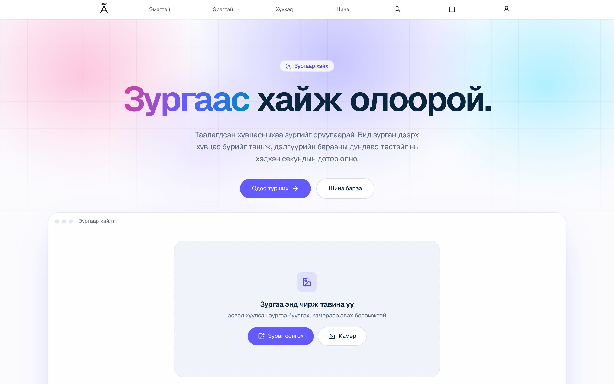
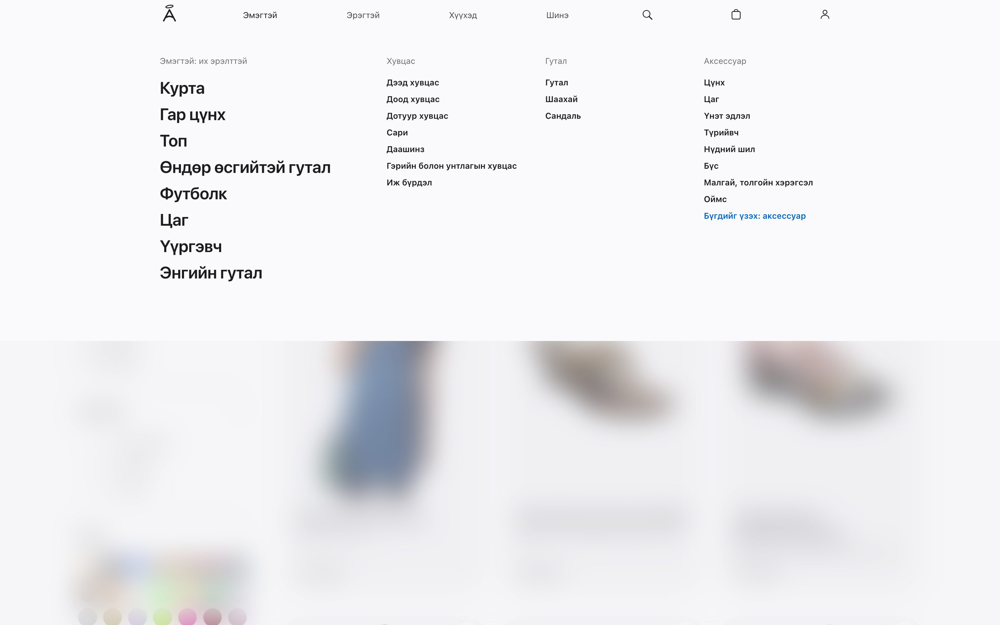
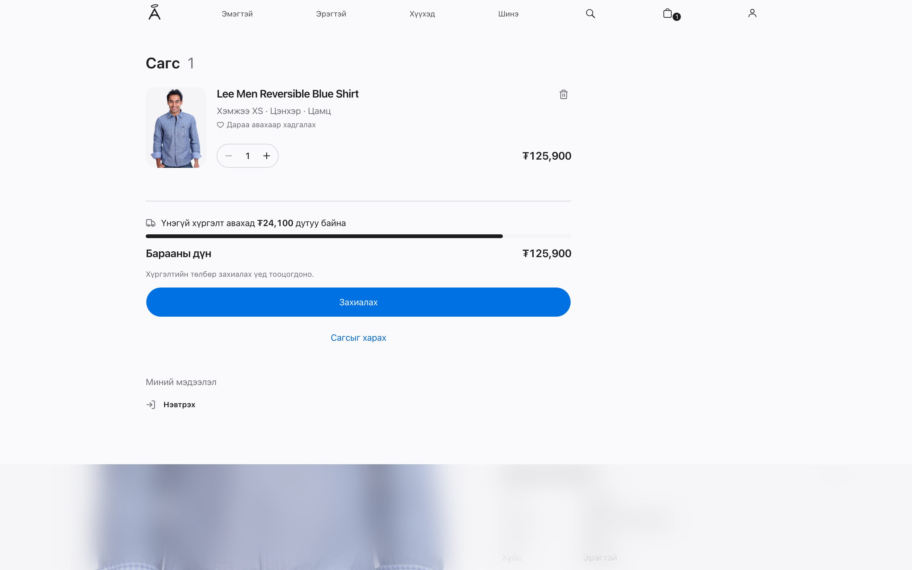
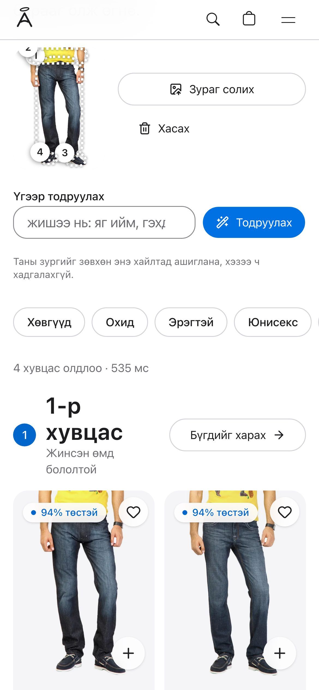

# Angel — Image-Based Similar Clothing Product Recommendation System

[](https://github.com/Iluminimal/Image-Based-Similar-Clothing-Product-Recommendation-System/actions/workflows/ci.yml)
[](LICENSE)

**Монгол** · [English](README.en.md)

Хувцасны зураг оруулахад төстэй барааг олж харуулдаг онлайн дэлгүүр. Дипломын төсөл.



| Ангиллын цэс | Сагс | Утсан дээрх хайлт |
| --- | --- | --- |
|  |  |  |

- **Хэрэглэгч:** зургаар болон үгээр хайх, сагс, захиалга, QPay төлбөр.
- **Агуулахын ажилтан:** бараа нэмэх, засах, устгах, захиалга илгээх.
- **Админ:** захиалга, төлбөр буцаах, хэрэглэгч, сэтгэгдэл, тайлан.

**Технологи:** Next.js, FastAPI, PostgreSQL + pgvector, Redis, FashionCLIP, YOLOv8.

## Шаардлага

macOS (Apple Silicon) дээр туршсан.

| Хэрэгсэл | Суулгах тушаал |
| --- | --- |
| git, make | `xcode-select --install` |
| Node.js 24 буюу түүнээс шинэ | `brew install node@24` |
| uv (Python-ийг өөрөө татна) | `brew install uv` |
| Docker Desktop | `brew install --cask docker-desktop` |

`brew` байхгүй бол эхлээд [Homebrew](https://brew.sh) суулгана. `node@24`-ийг `PATH`-д нэмээд терминалаа дахин нээнэ:

```bash
echo "export PATH=\"$(brew --prefix node@24)/bin:\$PATH\"" >> ~/.zshrc
```

## Ажиллуулах (датасетгүй)

Датасет, ML загвар татахгүй, 60 хиймэл бараатай ажиллана. Энэ горимд **зургаар хайлтын үр дүн утгагүй**.

**1.** Docker Desktop-ийг нээгээд:

```bash
git clone https://github.com/Iluminimal/Image-Based-Similar-Clothing-Product-Recommendation-System.git
cd Image-Based-Similar-Clothing-Product-Recommendation-System
make install
make infra   # өгөгдлийн сан асааж, .env файл үүсгэнэ
```

> [!IMPORTANT]
> Нэг компьютер дээрх энэ төслийн хоёр хуулбар **нэг өгөгдлийн санг** ашиглана. Тусад нь байлгах бол хоёр дахь
> хуулбарт `make infra`-аас өмнө `cp .env.example .env` хийж, `.env`-д `COMPOSE_PROJECT_NAME=angel2` нэмээд портуудыг
> солино.

**2.** `.env` файлд (macOS: `open -e .env`) эдгээр хоёр мөрийн утгыг солино:

```bash
EMBEDDER=fake
LOCALIZER=whole
```

**3.** Бараа үүсгээд API-г асаана:

```bash
make migrate
make seed-e2e   # жинхэнэ бараатай санд бүү ажиллуул
make api
```

**4.** Хоёр дахь терминалд, мөн төслийн folder-оос:

```bash
make web
```

Дэлгүүр: <http://localhost:3000>

## Жинхэнэ датасеттэй ажиллуулах

> [!WARNING]
> Өмнө нь датасетгүй горимоор ажиллуулсан бол **эхлээд** вэб, API-г зогсоогоод доорх тушаалуудыг ажиллуулна.
> `make infra-reset` өгөгдлийн санг **бүхэлд нь устгана**.
>
> ```bash
> make infra-reset
> rm -rf apps/web/.next
> make infra
> ```

1. [Fashion Product Images Dataset](https://www.kaggle.com/datasets/paramaggarwal/fashion-product-images-dataset)-ийг
   татна (том: ойролцоогоор 25 GB). Лиценз, ашиглах нөхцөлийг нь уншина.
2. «Ажиллуулах» хэсгийн 1-р алхмыг хийсэн байх ёстой. `.env`-д:

   ```bash
   DATASET_DIR=/Users/your-name/my-dataset   # styles.csv ба images/ байгаа folder
   EMBEDDER=fashion-clip
   LOCALIZER=yolo
   ```

3. Барааг ачаална. 8 GB санах ойтой M1 дээр 16–25 минут болно; турших бол `make ingest ARGS="--limit 500"`.

   ```bash
   make migrate
   make ingest
   ```

4. `make api`, `make web`-ийг хоёр терминалд ажиллуулна. ML загваруудыг (ойролцоогоор 0.8 GB) эхний удаа автоматаар
   татна.

## Нэвтрэх

Нэвтрэх хуудас: <http://localhost:3000/login>

- **Шинэ хэрэглэгч:** имэйлээ бичээд «Үргэлжлүүлэх», дараа нь «Имэйлээр код авах» дарна. Кодыг
  <http://localhost:8025> дээрээс харна. Утасны дугаараар бүртгүүлбэл код `make api` ажиллаж буй терминалын `sms_sent`
  мөрөнд гарна.
- **Админ, агуулахын ажилтан:** терминалаас үүсгэнэ. Нууц үгээ мартвал тушаалыг дахин ажиллуулна.

  ```bash
  make create-admin EMAIL=admin@example.com
  make create-warehouse EMAIL=warehouse@example.com
  ```

Хөгжүүлэлтэд жинхэнэ мөнгө авахгүй, туршилтын төлбөр гарна.

## Зогсоох, шинэчлэх, тест

**Зогсоох:** терминал бүрд `Ctrl+C`, дараа нь `make infra-down` (өгөгдөл үлдэнэ).

**Шинэчлэх** (вэб, API-г зогсоосны дараа):

```bash
git pull
make install
make infra
make migrate
```

**Тест** (`make infra`, `make migrate` хийсэн байх):

```bash
make test
make lint
make typecheck
```

## Түгээмэл асуудал

| Асуудал | Шийдэл |
| --- | --- |
| `make infra` Docker-той холбогдохгүй | Docker Desktop-ийг нээж, бүрэн асахыг хүлээнэ |
| `port is already allocated` | `.env`-д портыг (`POSTGRES_PORT`, `REDIS_PORT`, `MAILPIT_SMTP_PORT`) сольж, `DATABASE_URL`, `REDIS_URL`, `SMTP_PORT`-ыг тааруулна. Имэйл үзэх порт: `MAILPIT_UI_PORT` |
| <http://localhost:8000/readyz> 503 буцаана | Хариунаас аль шалгалт `fail` болсныг харна. Ихэвчлэн `make infra` ажиллаагүй байдаг |
| Бараа харагдахгүй, хуучин бараа харагдана эсвэл 500 алдаа гарна | Вэбийг зогсоож, `rm -rf apps/web/.next` хийгээд дахин асаана |
| API дахин асах бүрд системээс гарна | `.env`-ийн `JWT_SECRET`-д 32 ба түүнээс урт санамсаргүй утга өгнө |

Бусад тохиргоо: [`.env.example`](.env.example). Серверт байршуулах: [`docs/deploy.md`](docs/deploy.md). Бусад баримт:
[`docs/`](docs/README.md). Кодын тайлбарыг folder бүрийн `README.md`-ээс үзнэ.

## Лиценз

Энэ repo-ийн код [MIT](LICENSE) лицензтэй.

- Датасет repo-д ороогүй. Дэлгэцийн зургуудад түүний (Kaggle, paramaggarwal) барааны зураг харагдана. Ашиглахын өмнө
  нөхцөлийг нь шалгана.
- FashionCLIP загварыг MIT, YOLOv8m_fashion загварыг Apache-2.0 гэж тэмдэглэсэн.
- Ultralytics сан AGPL-3.0 эсвэл арилжааны лицензтэй.
