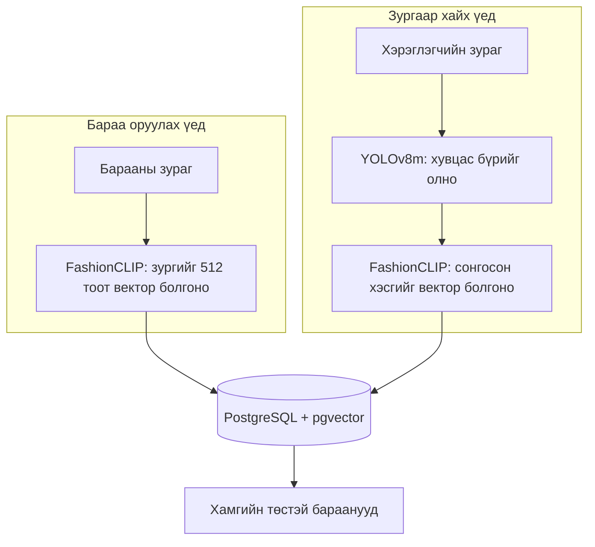
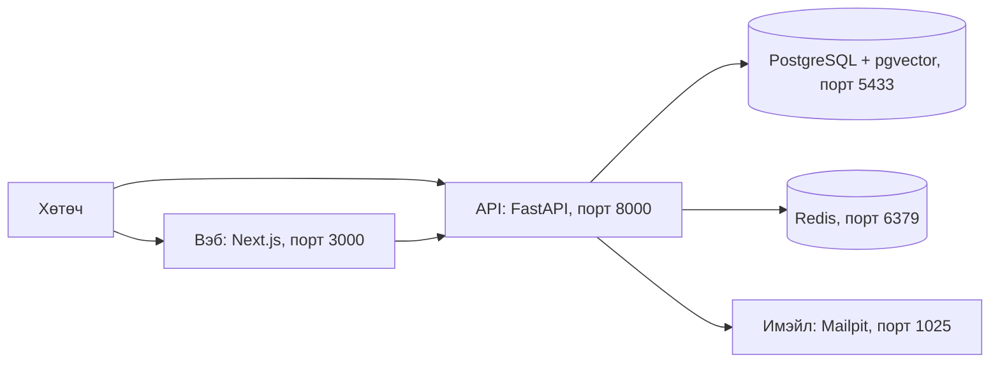

# Angel — Image-Based Similar Clothing Product Recommendation System

[](https://github.com/Iluminimal/Image-Based-Similar-Clothing-Product-Recommendation-System/actions/workflows/ci.yml)
[](LICENSE)

**Монгол** · [English](README.en.md)

**Зургаар хувцас хайх.** Хувцасны зургаа оруулах эсвэл камераар авахад Angel түүнтэй төстэй бараануудыг олж харуулна.
Энэ бол зургаар хайх боломжтой онлайн дэлгүүр, түүний админ ба агуулахын ажлын хэсгийг багтаасан дипломын төсөл.


| Ангиллын цэс | Сагс | Утсан дээрх хайлт |
| --- | --- | --- |
|  |  |  |

## Агуулга

- [Боломжууд](#боломжууд)
- [Хэрхэн ажилладаг вэ](#хэрхэн-ажилладаг-вэ)
- [Ашигласан технологи](#ашигласан-технологи)
- [Юу хэрэгтэй вэ](#юу-хэрэгтэй-вэ)
- [Хурдан эхлэх (датасетгүй)](#хурдан-эхлэх-датасетгүй)
- [Жинхэнэ датасеттэй ажиллуулах](#жинхэнэ-датасеттэй-ажиллуулах)
- [Хэрхэн ашиглах вэ](#хэрхэн-ашиглах-вэ)
- [Зогсоох, дахин асаах, шинэчлэх](#зогсоох-дахин-асаах-шинэчлэх)
- [Тохиргоо](#тохиргоо)
- [Тест ба чанарын шалгалт](#тест-ба-чанарын-шалгалт)
- [Серверт байршуулах](#серверт-байршуулах)
- [Түгээмэл асуудал ба шийдэл](#түгээмэл-асуудал-ба-шийдэл)
- [Төслийн бүтэц ба баримт бичиг](#төслийн-бүтэц-ба-баримт-бичиг)
- [Лиценз](#лиценз)

## Боломжууд

**Хэрэглэгч**

- Зургаар, үгээр (монгол, англи) эсвэл зураг дээр үг нэмж хайна. Нэг зураг дээрх хувцас, гутал, цүнхийг тусад нь олно.
  Камерын горимд хувцсыг шууд хүрээлж харуулна.
- Ангилал, шүүлтүүр, сэтгэгдэл, төстэй бараа, хадгалсан бараа.
- Сагс, захиалга, QPay төлбөр, захиалга цуцлах ба бараа буцаах хүсэлт.
- Имэйл эсвэл утсанд ирэх нэг удаагийн код, нууц үг, эсвэл Google-ээр нэвтэрнэ.

**Агуулахын ажилтан**

- Бараа нэмэх, засах. Үнэ, тоог жагсаалтаас шууд засна.
- Барааг унтраалгаар зарах эсвэл зарахаа болино. Хэзээ ч захиалагдаагүй барааг устгана.
- Захиалгыг илгээнэ. Агуулахад байгаа барааг тоолж бүртгэнэ.

**Админ**

- Хяналтын самбар, захиалга, хэрэглэгч, сэтгэгдэл, үйлдлийн журнал, CSV тайлан.
- Төлбөр буцаана, захиалга цуцлах ба бараа буцаах хүсэлтийг шийднэ. Барааг зөвхөн харна.

Сайт анхнаасаа монгол хэлтэй. Хуудасны доод хэсгээс англи хэл рүү солино. Үнэ төгрөгөөр.

## Хэрхэн ажилладаг вэ



1. Барааны зураг бүрийг [FashionCLIP](https://huggingface.co/patrickjohncyh/fashion-clip) загвар 512 тооноос бүрдсэн
   вектор болгоно. Векторыг [pgvector](https://github.com/pgvector/pgvector)-тэй PostgreSQL-д хадгална (HNSW индекс,
   cosine зай).
2. Хайхаар оруулсан зураг дээр [YOLOv8m](https://huggingface.co/NovaAstro/YOLOv8m_fashion) загвар хувцас бүрийг тусад нь
   олно.
3. Сонгосон хэсгийг мөн адил вектор болгоод, өгөгдлийн сан хамгийн ойрхон векторуудын барааг буцаана.

Хайлтад оруулсан зураг, камерын кадрыг хадгалахгүй. FashionCLIP-ийг Marqo-FashionSigLIP, ResNet-50-тай харьцуулсан
туршилтын дүнг [`docs/ml-comparison.md`](docs/ml-comparison.md)-ээс үзнэ үү.

Ажиллаж буй системийн бүтэц:



## Ашигласан технологи

| Хэсэг | Технологи |
| --- | --- |
| Вэб | Next.js 16, React 19, TypeScript, Tailwind CSS v4, shadcn/ui, TanStack Query, next-intl |
| API | Python 3.12, FastAPI, Pydantic v2, SQLAlchemy 2 (async), Alembic |
| Өгөгдөл | PostgreSQL 18 + pgvector, Redis 8 |
| ML | PyTorch, FashionCLIP, YOLOv8 (Ultralytics) |
| Хэрэгсэл | uv, Ruff, mypy, ESLint, Vitest, pytest, Playwright, Docker, GitHub Actions |

## Юу хэрэгтэй вэ

### Компьютер

| Зүйл | Тайлбар |
| --- | --- |
| Үйлдлийн систем | **macOS (Apple Silicon)** дээр хөгжүүлж туршсан. Windows дээр туршаагүй (WSL2 ашиглаж үзэж болно). Linux дээр гараар асааж туршаагүй: GitHub Actions тестийг Ubuntu дээр ажиллуулдаг. Linux дээр PyTorch-ийн CPU хувилбар суудаг. |
| Санах ой | Хөгжүүлэлтийг 8 GB санах ойтой M1 дээр хийсэн. |
| Дискний зай | Төслийн сангууд ба Docker image: 4 GB орчим. Жинхэнэ загвар: нэмээд 0.8 GB. Жинхэнэ датасет: доорх [хэсгийг](#жинхэнэ-датасеттэй-ажиллуулах) үзнэ үү. |
| Интернэт | Анх суулгах, загвар татах үед хэрэгтэй. |

### Хэрэгслүүд

| Хэрэгсэл | macOS дээр суулгах | Шалгах |
| --- | --- | --- |
| git, make | `xcode-select --install` | `git --version`, `make --version` |
| [Node.js](https://nodejs.org) 24 буюу түүнээс шинэ (CI нь 24-ийг ашиглана; 26 дээр туршсан) | `brew install node@24` (доорх тайлбарыг үзнэ үү) | `node -v` |
| [uv](https://docs.astral.sh/uv/getting-started/installation/) | `brew install uv` | `uv --version` |
| [Docker Desktop](https://docs.docker.com/get-started/get-docker/) | `brew install --cask docker-desktop` | `docker compose version` |

- `brew` тушаал ажиллахгүй бол эхлээд [Homebrew](https://brew.sh) суулгана.
- Homebrew-ийн `node@24` өөрөө `PATH`-д нэмэгддэггүй. Дараах мөрийг ажиллуулаад терминалаа дахин нээнэ:

  ```bash
  echo "export PATH=\"$(brew --prefix node@24)/bin:\$PATH\"" >> ~/.zshrc
  ```

- **Python тусад нь суулгах шаардлагагүй.** `uv` хэрэгтэй хувилбарыг (3.12) өөрөө татна.
- Docker Desktop-ийг суулгасны дараа **нэг удаа нээж**, бүрэн асахыг хүлээнэ.

## Хурдан эхлэх (датасетгүй)

Энэ зам хамгийн хурдан: датасет болон ML загвар татахгүй. 60 хиймэл бараа үүсгэнэ. Дэлгүүр, захиалга, админ,
агуулахын хэсэг бүгд ажиллана.

> [!NOTE]
> Энэ горимд **зургаар хайлт утгагүй үр дүн гаргана**: хайлт ажиллах ч төстэй байдлыг үнэлэхгүй. Жинхэнэ хайлтыг
> үзэхийн тулд [жинхэнэ датасетийг](#жинхэнэ-датасеттэй-ажиллуулах) ачаална.

### 1. Кодыг татах

```bash
git clone https://github.com/Iluminimal/Image-Based-Similar-Clothing-Product-Recommendation-System.git
cd Image-Based-Similar-Clothing-Product-Recommendation-System
```

**Дараах бүх тушаалыг энэ үндсэн folder-оос ажиллуулна.**

### 2. Сангуудыг суулгах

```bash
make install
```

API (Python) болон вэб (Node.js) сангууд суулгагдана. Анх удаа хэдэн минут болж болно. `npm warn` гэж эхэлсэн
санамж алдаа биш. Тушаал алдаагүй дуусвал амжилттай.

### 3. Өгөгдлийн сан, Redis, Mailpit асаах

Docker Desktop ажиллаж байх ёстой.

```bash
make infra
```

`.env` тохиргооны файлыг `.env.example`-ээс үүсгэж, гурван контейнер асаана. Гурвуулаа `Healthy` болвол амжилттай.

> [!IMPORTANT]
> Docker дээрх project-ийн нэр үргэлж `angel`. Нэг компьютер дээр энэ төслийн **хоёр хуулбар** байвал хоёулаа
> **нэг өгөгдлийн санг** ашиглана: нэгэнд нь ажиллуулсан `make seed-e2e`, `make infra-reset` нөгөөгийнх нь өгөгдөлд
> нөлөөлнө. Тусад нь байлгах бол хоёр дахь хуулбарт эхлээд `cp .env.example .env` хийж, `.env`-д
> `COMPOSE_PROJECT_NAME=angel2` мөр нэмээд [портуудыг нь солино](#түгээмэл-асуудал-ба-шийдэл). Дараа нь `make infra`
> ажиллуулна.

### 4. Датасетгүй горим сонгох

`.env` файлыг засварлагчаар нээнэ (macOS: `open -e .env`). Дараах **хоёр мөрийг** олж, утгыг нь солино:

```bash
EMBEDDER=fake
LOCALIZER=whole
```

### 5. Хүснэгт ба туршилтын бараа үүсгэх

```bash
make migrate    # өгөгдлийн сангийн хүснэгтүүд
make seed-e2e   # 60 хиймэл бараа
```

`make seed-e2e`-г жинхэнэ бараатай санд бүү ажиллуулаарай: 60 хиймэл бараа нэмэгдэнэ.

### 6. Ажиллуулах

**Хоёр тусдаа терминал** нээж, хоёуланд нь үндсэн folder-т орно:

```bash
make api   # 1-р терминал: API
```

```bash
make web   # 2-р терминал: вэб
```

Хоёр тушаал хоёулаа ажиллаж байх ёстой тул терминалуудаа хааж болохгүй.

### 7. Шалгах

| Нээх хаяг | Амжилттай бол |
| --- | --- |
| <http://localhost:8000/readyz> | `"status":"ok"` гэж гарч, `database`, `redis`, `model` гурвуулаа `ok` |
| <http://localhost:3000> | Дэлгүүрийн нүүр хуудас, туршилтын бараанууд |

Анх нээхэд хуудас хэдэн секунд бэлтгэгдэнэ.

## Жинхэнэ датасеттэй ажиллуулах

[Хурдан эхлэх](#хурдан-эхлэх-датасетгүй) хэсгийн **1–3-р алхмыг** хийсний дараа үргэлжлүүлнэ.

### 1. Датасетийг татах

Kaggle бүртгэлээр нэвтэрч
[Fashion Product Images Dataset](https://www.kaggle.com/datasets/paramaggarwal/fashion-product-images-dataset)-ийг
татна. **Татахын өмнө лиценз, ашиглах нөхцөлийг нь уншина уу.**

- Бүтэн хувилбар том: Kaggle-ийн хуудсанд нийт хэмжээг ойролцоогоор **25 GB** гэж заасан (хуудасны өөр хэсэгт 15.7 GB
  гэж харагддаг). Татаж задлах зай хангалттай эсэхийг урьдчилан шалгана.
- [Жижиг хувилбар](https://www.kaggle.com/datasets/paramaggarwal/fashion-product-images-small) (ойролцоогоор 600 MB)
  зургийн нягтрал багатай. Энэ төсөл дээр туршаагүй.

Задалсны дараа `styles.csv` файл болон `images/` folder хоёрыг **хамт агуулсан** folder-ийг олно:

```
my-dataset/          ← DATASET_DIR энэ folder-ийг заана
├── styles.csv
└── images/
    ├── 1163.jpg
    └── ...
```

### 2. Тохируулах

`.env` файлд:

```bash
DATASET_DIR=/Users/your-name/Datasets/my-dataset
EMBEDDER=fashion-clip
LOCALIZER=yolo
```

`DATASET_DIR`-д өөрийн folder-ийн бүтэн замыг бичнэ. `EMBEDDER`, `LOCALIZER` хоёр анхнаасаа эдгээр утгатай байдаг.

> [!WARNING]
> Өмнө нь датасетгүй горимоор ажиллуулсан бол эхлээд вэб, API-г зогсоож (`Ctrl+C`), хуучин туршилтын өгөгдлийг
> арилгана. `make infra-reset` нь **өгөгдлийн санг бүхэлд нь устгана** (бүртгэл, захиалга мөн устна).
>
> ```bash
> make infra-reset
> rm -rf apps/web/.next    # вэбийн хадгалсан хуучин хариунууд
> make infra
> ```

### 3. Барааг ачаалах

```bash
make migrate
make ingest ARGS="--limit 500"   # эхлээд 500 бараагаар турших
make ingest                      # бүх бараа
```

- Эхний удаа FashionCLIP загварыг (ойролцоогоор 0.6 GB) Hugging Face-ээс татна. Хувцас олдог YOLO загварыг (ойролцоогоор
  0.2 GB) API анх асахдаа татна.
- 8 GB санах ойтой M1 дээр бүх 41,885 барааг ачаалахад **16–25 минут** болсон.
- Ачаалсан барааны жижиг зургууд `data/media/` дотор (ойролцоогоор 1.3 GB), өгөгдлийн сан ойролцоогоор 0.25 GB болно.
- Дундаас нь `Ctrl+C`-ээр зогсоож болно. Дахин ажиллуулахад үлдсэнээс нь үргэлжилнэ.
- Датасетэд үнэ, үлдэгдэл байхгүй тул тэдгээрийг тогтмол дүрмээр үүсгэдэг.

Дараа нь `make api`, `make web`-ийг ажиллуулна. Нарийн тайлбарыг [`docs/ml-pipeline.md`](docs/ml-pipeline.md)-ээс үзнэ
үү.

## Хэрхэн ашиглах вэ

### Хаягууд

| Юу | Хаяг |
| --- | --- |
| Дэлгүүр | <http://localhost:3000> |
| Нэвтрэх (хэрэглэгч, ажилтан бүгд) | <http://localhost:3000/login> |
| Админ ба агуулахын хэсэг | <http://localhost:3000/admin> |
| API-ийн баримт (Swagger) | <http://localhost:8000/api/v1/docs> |
| Илгээсэн имэйл үзэх (Mailpit) | <http://localhost:8025> |
| API бэлэн эсэхийг шалгах | <http://localhost:8000/readyz> |

### Хэрэглэгчээр бүртгүүлэх

1. <http://localhost:3000/login> дээр имэйл хаяг эсвэл утасны дугаараа бичээд **«Үргэлжлүүлэх»** дарна.
2. **Утасны дугаар** бол 6 оронтой код шууд илгээгдэнэ. **Имэйл** бол нууц үг асуух дэлгэц гарна: шинэ хэрэглэгч
   **«Имэйлээр код авах»** дарна.
3. Кодоо оруулаад нэрээ бичнэ.

Хөгжүүлэлтэд жинхэнэ имэйл, SMS илгээхгүй. Кодоо эндээс харна:

- **Имэйлийн код:** <http://localhost:8025> (Mailpit).
- **SMS код:** `make api` ажиллаж буй терминалаас `sms_sent` гэсэн мөрийг олно. Код нь `"body"`-ийн эхний 6 цифр.

Улсын кодгүй бичсэн дугаарыг Монголын дугаар гэж үзнэ (`DEFAULT_PHONE_REGION`).

### Админ, агуулахын ажилтан үүсгэх

Ажилтныг вэбээс бүртгүүлэх боломжгүй. Терминалаас үүсгэнэ (`make infra`, `make migrate` хийсэн байх):

```bash
make create-admin EMAIL=admin@example.com
make create-warehouse EMAIL=warehouse@example.com
```

Нууц үгийг (10–128 тэмдэгт) хоёр удаа асууна. Бичих үед дэлгэцэнд харагдахгүй. Дараа нь
<http://localhost:3000/login> дээр имэйл, нууц үгээрээ нэвтэрнэ. Ижил тушаалыг дахин ажиллуулбал нууц үгийг шинэчилнэ.

### Зургаар хайж үзэх

Нүүр хуудасны эсвэл хайлтын талбар доторх **«Зургаар хайх»** товчийг дарна (эсвэл <http://localhost:3000/search> хуудсыг
нээнэ). Зургаа сонгох, чирж тавих, хуулж буулгах (paste) эсвэл камераар авах боломжтой. JPEG, PNG, WebP зураг
тохиромжтой.

### Захиалга ба туршилтын төлбөр

1. Бараа сонгож (хэмжээтэй бараанд хэмжээгээ сонгоно) сагсанд нэмнэ.
2. Нэвтэрч, хүргэлтийн хаягаа оруулна.
3. Хөгжүүлэлтэд `PAYMENTS_MODE=offline` тул **туршилтын төлбөр** гарна. Жинхэнэ мөнгө авахгүй.

Жинхэнэ QPay холбох заавар: [`docs/commerce.md`](docs/commerce.md).

### Админ самбарт жишээ өгөгдөл оруулах

Бараа ачаалсны дараа:

```bash
make seed-demo        # зохиомол хэрэглэгч, захиалга, сэтгэгдэл
make seed-demo-clean  # тэдгээрийг устгах
```

Зохиомол хэрэглэгчдийн имэйл `demo-...@example.com`, нууц үг нь `DemoPass12345`. Зөвхөн хөгжүүлэлтэд ашиглана.

## Зогсоох, дахин асаах, шинэчлэх

**Зогсоох:** `make api`, `make web` ажиллаж буй терминал бүрд `Ctrl+C`, дараа нь:

```bash
make infra-down   # контейнеруудыг зогсооно; өгөгдөл хадгалагдана
```

**Дахин асаах:** Docker Desktop-ийг нээгээд `make infra`, дараа нь хоёр терминалд `make api`, `make web`.

**Шинэ код татаж шинэчлэх:** вэб, API-г зогсоогоод:

```bash
git pull
make install
make infra
make migrate
```

Дараа нь `make api`, `make web`-ийг дахин ажиллуулна.

**Эхнээс нь эхлэх:** `make infra-reset` нь өгөгдлийн санг **бүрмөсөн устгана**. Дараа нь `rm -rf apps/web/.next`,
`make infra`, `make migrate` хийж, барааг дахин оруулна.

## Тохиргоо

Бүх тохиргоо үндсэн folder-ийн `.env` файлд байна. `make infra` анх удаа [`.env.example`](.env.example)-ээс үүсгэнэ.
Тэр файл дотор утга бүрийн тайлбар бий. Өөрчилсний дараа API-г дахин асаана. **`.env` файлыг git-д хэзээ ч оруулахгүй.**

| Хувьсагч | Юунд хэрэгтэй вэ | Хөгжүүлэлтийн анхны утга |
| --- | --- | --- |
| `EMBEDDER`, `LOCALIZER` | ML загварууд. Датасетгүй горимд `fake`, `whole` | `fashion-clip`, `yolo` |
| `DATASET_DIR` | Датасетийн folder (зөвхөн `make ingest`) | жишээ зам |
| `DATABASE_URL`, `REDIS_URL` | Өгөгдлийн сан ба Redis-ийн хаяг | `localhost:5433`, `localhost:6379` |
| `JWT_SECRET` | Нэвтрэлтийн нууц түлхүүр. Хоосон бол API дахин асах бүрд бүгд системээс гарна | хоосон |
| `PAYMENTS_MODE` | `offline` туршилтын төлбөр, `qpay` жинхэнэ | `offline` |
| `MAIL_MODE`, `SMTP_*` | Имэйл илгээх | Mailpit (`smtp`, порт 1025) |
| `SMS_MODE`, `TWILIO_*` | SMS илгээх: `console` (log-д бичих) эсвэл `twilio` | `console` |
| `GOOGLE_CLIENT_ID`, `GOOGLE_CLIENT_SECRET` | Google-ээр нэвтрэх. Хоосон бол товч харагдахгүй | хоосон |
| `RATE_LIMIT_ENABLED` | Хэт олон хүсэлтийг хязгаарлах | `true` |

Нууц түлхүүр үүсгэх жишээ: `openssl rand -base64 48`.

Вэбийн хаягийн тохиргоо тусдаа: анхны утга нь `http://localhost:8000` (API) ба `http://localhost:3000` (вэб). Өөрчлөх
бол [`apps/web/.env.example`](apps/web/.env.example)-ийг `apps/web/.env.local` болгож хуулна.

## Тест ба чанарын шалгалт

```bash
make infra migrate
make test        # API (pytest) ба вэбийн (Vitest) тест
make lint        # Ruff, ESLint
make typecheck   # mypy, TypeScript
```

| Бусад тушаал | Юу хийдэг вэ |
| --- | --- |
| `make test-ml` | Жинхэнэ FashionCLIP, YOLO загвартай тест (анх удаа ойролцоогоор 0.8 GB татна) |
| `make api-types` | API өөрчлөгдсөний дараа вэбийн TypeScript төрлийг шинэчилнэ |
| `make e2e` | Браузерын (Playwright) тест |
| `make help` | Бүх тушаалын жагсаалт |

Браузерын тестийг ажиллуулахын өмнө [`docs/e2e.md`](docs/e2e.md)-ийг уншина уу. Анх удаа
`cd apps/web && npx playwright install chromium` хэрэгтэй.

> [!WARNING]
> `make e2e`-г өөрийн өгөгдөлтэй санд ажиллуулбал `admin@example.com`, `warehouse@example.com` хаягийн **нууц үгийг
> сольж**, туршилтын өгөгдөл нэмнэ. `docs/e2e.md`-д тусдаа санд ажиллуулах аргыг тайлбарласан.

GitHub Actions ([`.github/workflows/ci.yml`](.github/workflows/ci.yml)) `main` branch руу push хийх бүрд болон pull
request дээр lint, төрлийн шалгалт, тест, браузерын тест, Docker image build-ийг ажиллуулна.

## Серверт байршуулах

Нэг сервер дээр Docker Compose ашиглана: Caddy (HTTPS) → вэб → API → PostgreSQL, Redis.

**Эхлээд заавал** [`docs/production-checklist.md`](docs/production-checklist.md) (нээхээс өмнө засах, бэлдэх зүйлс) ба
[`docs/deploy.md`](docs/deploy.md) (алхам алхмаар заавар)-ыг уншина уу.

- 4 GB ба түүнээс их санах ойтой, ойролцоогоор 15 GB зайтай сервер, домэйн нэр хэрэгтэй.
- QPay, Twilio (SMS), SMTP (имэйл), Google OAuth бүртгэл хэрэгтэй. Туршилтын горимтой тохиргоогоор production API
  асахгүй.

```bash
cp .env.prod.example .env.prod   # CHANGE_ME гэсэн утга бүрийг бөглөнө
make deploy-check                # дутуу, зөвшөөрөгдөөгүй утгыг шалгана
docker compose -f infra/docker-compose.prod.yml --env-file .env.prod up -d --build
```

## Түгээмэл асуудал ба шийдэл

| Асуудал | Шийдэл |
| --- | --- |
| `make: command not found`, `git: command not found` | macOS дээр `xcode-select --install` |
| `make infra` Docker-той холбогдож чадахгүй | Docker Desktop-ийг нээж, бүрэн асахыг хүлээнэ |
| `port is already allocated` (5433, 6379, 1025, 8025) | `.env` дэх портыг солино. `POSTGRES_PORT`-ыг сольбол `DATABASE_URL`, `REDIS_PORT`-ыг сольбол `REDIS_URL`, `MAILPIT_SMTP_PORT`-ыг сольбол `SMTP_PORT`-ыг мөн адил болгоно. `MAILPIT_UI_PORT` бол имэйл үзэх хаягийн порт |
| 3000 эсвэл 8000 порт завгүй | `lsof -nP -iTCP:3000 -sTCP:LISTEN` (эсвэл `8000`) тушаалаар аль программ эзэлснийг олж зогсооно. Вэб өөр порт дээр асвал тохиргоо таарахгүй |
| `/readyz` 503 буцаана | Хариунд аль нь (`database`, `redis`, `model`) `fail` болсныг харна. Ихэвчлэн `make infra` ажиллаагүй байдаг |
| API-ийн log-д `relation ... does not exist` | `make migrate` ажиллуулна |
| Дэлгүүрт бараа алга | `make seed-e2e` эсвэл `make ingest` ажиллуулсан эсэхийг шалгана. Дараа нь хэдэн минут хүлээх, эсвэл вэбийг зогсоож `rm -rf apps/web/.next` хийгээд дахин асаана |
| Сангаа дахин үүсгэсний дараа хуучин бараа, үнэ харагдана | Вэб API-ийн хариуг дискэнд түр хадгалдаг. Вэбийг зогсоож `rm -rf apps/web/.next` хийгээд дахин асаана |
| Шинэ код татсаны дараа хуудас 500 алдаа өгнө | `make web`-ийг зогсоож, `make install` хийгээд дахин асаана. Болохгүй бол `rm -rf apps/web/.next` |
| API анх асахдаа удаан байна | Жинхэнэ загварын горимд анх удаа загвар татдаг. Датасетгүй бол `.env`-д `EMBEDDER=fake`, `LOCALIZER=whole` эсэхийг шалгана |
| Нэг удаагийн код ирэхгүй | Имэйлийг <http://localhost:8025> дээрээс, SMS кодыг API-ийн терминалаас харна. Дахин код авахаас өмнө 60 секунд хүлээнэ. Нэг цагт 5 хүртэл удаа илгээнэ |
| «Хэт олон хүсэлт илгээлээ» (429) | Түр хүлээнэ. Зөвхөн өөрийн компьютер дээр туршиж байгаа бол `.env`-д `RATE_LIMIT_ENABLED=false` |
| Ажилтны нууц үг мартсан | `make create-admin EMAIL=...` эсвэл `make create-warehouse EMAIL=...`-ийг дахин ажиллуулж шинэ нууц үг өгнө |
| Хоёр шатлалт нэвтрэлтийн утсаа алдсан | `make reset-2fa EMAIL=...` |
| API дахин асах бүрд системээс гарна | `.env`-ийн `JWT_SECRET`-д 32 ба түүнээс урт санамсаргүй утга өгнө |
| Камер асахгүй | Хөтөч камерыг зөвхөн `localhost` эсвэл HTTPS хаяг дээр зөвшөөрдөг. Хөтчийн камерын зөвшөөрлийг шалгана |

## Төслийн бүтэц ба баримт бичиг

```
apps/
  api/             Backend (FastAPI): routes → services → repositories → models
    src/angel/         код
    migrations/        өгөгдлийн сангийн өөрчлөлтүүд (Alembic)
    tests/             тест
  web/             Frontend (Next.js)
    src/               код
    messages/          монгол, англи бичвэр
    e2e/               браузерын тест
scripts/           датасет ачаалах, жишээ өгөгдөл, хэмжилтийн скриптүүд
infra/             Docker Compose, Caddy
docs/              баримт бичиг, дэлгэцийн зураг, хэмжилтийн үр дүн
```

- **Кодыг унших:** гол folder бүрт монголоор бичсэн `README.md` бий. Тэнд юу байдаг, шинэ зүйлийг хаана нэмэхийг
  тайлбарласан. Эхлэх газар: [`apps/api/src/angel/README.md`](apps/api/src/angel/README.md),
  [`apps/web/src/README.md`](apps/web/src/README.md).
- **Монгол бичвэрийн нэр томьёо:** [`docs/glossary-mn.md`](docs/glossary-mn.md).
- **Баримт бичиг** (ихэнх нь англиар): [Архитектур](docs/architecture.md) ·
  [Хөгжүүлэлтийн гарын авлага](docs/development.md) · [Шаардлага](docs/SPEC.md) · [Нэвтрэлт](docs/accounts.md) ·
  [Худалдаа](docs/commerce.md) · [Админ](docs/admin.md) · [Хайлтын API](docs/search-api.md) ·
  [ML pipeline](docs/ml-pipeline.md) · [Frontend](docs/frontend.md) · [Deploy](docs/deploy.md) ·
  [End-to-end тест](docs/e2e.md)

## Лиценз

Энэ repository-ийн код [MIT](LICENSE) лицензтэй. Гуравдагч этгээдийн дараах зүйлс өөрийн нөхцөлтэй:

- **Датасет** repository-д ороогүй. Энэ хуудасны дэлгэцийн зургуудад Kaggle дээрх
  [paramaggarwal-ийн Fashion Product Images](https://www.kaggle.com/datasets/paramaggarwal/fashion-product-images-dataset)
  датасетийн барааны зураг харагдана. Татахын өмнө лиценз, ашиглах нөхцөлийг нь шалгана. Барааны зургийг дахин,
  ялангуяа арилжааны зорилгоор ашиглах эрхийг тусад нь тодруулна.
- **FashionCLIP** загварын хуудсанд MIT лиценз гэж тэмдэглэсэн.
- **YOLOv8m_fashion** загварын жинг Apache-2.0 гэж тэмдэглэсэн. Жин нь pickle форматтай тул код зөвхөн тогтсон
  commit-оос татна.
- **Ultralytics** сан AGPL-3.0 лицензтэй (эсвэл тус компанийн арилжааны лиценз). Эх кодоо нээхгүйгээр үйлчилгээ гаргах
  бол нөхцөлийг нь заавал шалгана.
